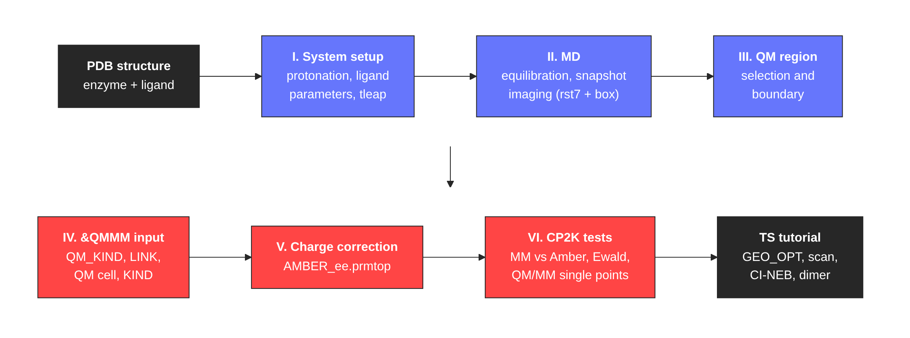

 

<b>This tutorial aims to prepare, step by step, a QM/MM model of an enzyme-ligand complex for CP2K, starting from a PDB structure and ending with a validated set of CP2K inputs: an Amber topology and equilibrated coordinates, the &QMMM section (QM atoms, QM/MM links and QM cell), a charge-corrected topology for electrostatic embedding, and single-point tests that confirm the setup before any expensive calculation is started.</b>

It is the companion of the <a href="https://arvpinto.github.io/enzyme_neb_cp2k/" target="_blank">Tutorial for Transition State (TS) searches of Enzymatic Reaction Mechanisms using QM/MM methods in CP2K</a>, which starts exactly where this one ends. Most of the information here came from the <a href="https://www.cp2k.org/" target="_blank">CP2K site</a>, the <a href="https://manual.cp2k.org/" target="_blank">CP2K manual</a>, the <a href="https://ambermd.org/tutorials/" target="_blank">Amber tutorials</a>, the <a href="https://groups.google.com/g/cp2k" target="_blank">CP2K discussion group</a> and the BioExcel QM/MM material listed at the bottom of this page. You should also follow the good practices found in the literature for the specific chemistry of your system.

 

    

 

---

 

<h3>
<b> Example system </b>
</h3>

All the commands and outputs shown in the tutorial come from a worked example: human &alpha;-thrombin, a trypsin-like serine protease with the classic Ser195/His57/Asp102 catalytic triad, in complex with a D-Phe-Pro-benzylamide inhibitor (ligand <i>lig_5</i> of the <a href="https://github.com/openforcefield/protein-ligand-benchmark" target="_blank">OpenFF protein-ligand benchmark</a>, prepared from the crystal structure <a href="https://www.rcsb.org/structure/2ZFF" target="_blank">2ZFF</a>). The system has about 42 500 atoms after solvation. Thrombin uses the chymotrypsin numbering scheme, with insertion codes, so the residues of the catalytic triad have different numbers in the Amber topology (His57 = 44, Asp102 = 100, Ser195 = 206). Keeping track of this kind of renumbering is part of the work, and we point it out along the way.

The steps are general and apply to any enzyme-substrate or enzyme-inhibitor complex parameterized with an Amber force field. Replace the residue numbers, masks and file names with those of your system.

 

<h3>
<b> Requirements </b>
</h3>

- 
<a href="https://ambermd.org/AmberTools.php" target="_blank">AmberTools</a> (pdb4amber, antechamber, parmchk2, tleap, cpptraj, ParmEd) and an MD engine (pmemd.cuda, pmemd or sander). The example was run with AmberTools 23.

- 
<a href="https://www.cp2k.org/" target="_blank">CP2K</a>, compiled with MPI (cp2k.psmp or cp2k.popt). The inputs were tested with CP2K 2026.2.

- 
<a href="https://github.com/jensengroup/propka" target="_blank">PROPKA 3</a> (pip install propka) for pKa estimates, and <a href="https://www.ks.uiuc.edu/Research/vmd/" target="_blank">VMD</a> for visualization and atom selections.

- 
Python 3 with ParmEd and NumPy (both come with AmberTools, or pip install parmed numpy) to run the scripts of this repository.

 

<h3>
<b> Files </b>
</h3>

| File | Description |
| :--- | :--- |
| <a href="scripts/cp2k_qmmm_setup.py">cp2k_qmmm_setup.py</a> | Builds the &QMMM include file (QM_KIND, LINK, QM cell), the &KIND sections, the QM region XYZ and the charge-corrected topology |
| <a href="scripts/prmtop_fix_types.py">prmtop_fix_types.py</a> | Renames atom types that CP2K cannot read from a prmtop (e.g. Ca2+) |
| <a href="scripts/mol2_charge_fix.py">mol2_charge_fix.py</a> | Makes the ligand partial charges add up to an integer |
| <a href="scripts/cp2k_ewald_scan.sh">cp2k_ewald_scan.sh</a> | Scans the Ewald ALPHA parameter with CP2K single points |
| <a href="scripts/plot_ewald_scan.py">plot_ewald_scan.py</a> | Plots the output of cp2k_ewald_scan.sh |
| <a href="AMBER_INPUTS.zip">AMBER_INPUTS.zip</a> | tleap, MD (min1, min2, heat, npt, prod), run_md.sh and cpptraj inputs |
| <a href="CP2K_INPUTS.zip">CP2K_INPUTS.zip</a> | CP2K inputs for the MM validation, the Ewald scan and the QM/MM single points, with the files generated for the example |

 

<b> Once you have a PDB structure of your enzyme-ligand complex, you are ready to start this tutorial. </b>

*As in the TS tutorial, the QM method of the provided QM/MM inputs is SCC-DFTB with the D3(0) dispersion correction, which allows for fast tests but has several limitations. Check that the method you choose has parameters for every element of your QM region (for example, the SCC-DFTB set distributed with CP2K has no fluorine, which is why the fluorinated ligand of the benchmark was replaced by its unsubstituted analogue in this example).

---

### Useful Links:

- <a href="https://manual.cp2k.org/trunk/methods/qm_mm/builtin.html" target="_blank">CP2K manual: QM/MM with the built-in QM/MM driver (formerly the "QMMM for biochemical systems" howto)</a>
- <a href="https://docs.bioexcel.eu/2020_06_09_online_ambertools4cp2k/" target="_blank">Preparing to run biomolecular QM/MM simulations with CP2K using AmberTools</a>
- <a href="https://github.com/bioexcel/cp2K_qmmm_tutorials_for_biological_simulations" target="_blank">QM/MM tutorials adapted to CP2K</a>
- <a href="https://docs.bioexcel.eu/qmmm_simulation_bpg/en/main/index.html" target="_blank">Best Practices in QM/MM Simulation of Biomolecular Systems</a>
- <a href="https://arvpinto.github.io/enzyme_neb_cp2k/" target="_blank">Tutorial for TS searches of enzymatic reaction mechanisms using QM/MM methods in CP2K</a>
