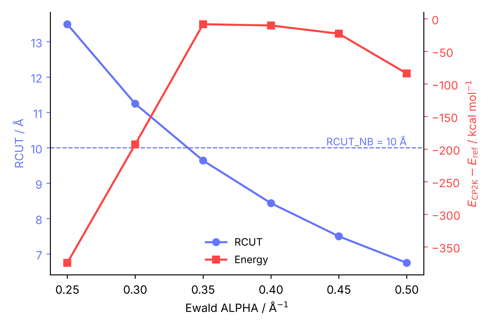

 
<h2> 
 <b>VI - Testing the setup in CP2K</b> 
</h2>

 

<pre style="color: white; background-color: black;">
&GLOBAL
    RUN_TYPE ENERGY
...
</pre>

---

 

Before starting geometry optimizations, scans or NEB calculations, a few single-point energies confirm that CP2K reproduces the force field, that the long-range electrostatics are converged and that the QM/MM model runs as intended. Each of these tests takes seconds to minutes, and every problem they catch would otherwise contaminate every later calculation. All inputs are in <a href="CP2K_INPUTS.zip">CP2K_INPUTS.zip</a>.

 

<h3> 
<b> MM energy: CP2K against Amber </b>
 </h3>

 

- 
The reference is a sander single point of the same coordinates with the same cutoff, without the long-range dispersion correction (vdwmeth=0), which CP2K does not apply:

<pre style="color: white; background-color: black;">
Single-point energy for comparison with CP2K (no long-range vdW correction)
&cntrl
  imin=1, maxcyc=1, ncyc=1, ntb=1, cut=10.0, ntpr=1, ntxo=1,
/
&ewald
  vdwmeth=0,
/
</pre>

<pre style="color: white; background-color: black;">
sander -O -i sp_sander.in -o sp_sander.out -p AMBER.prmtop -c AMBER.rst7 -r tmp.rst7
</pre>

<pre style="color: white; background-color: black;">
   NSTEP       ENERGY          RMS            GMAX         NAME    NUMBER
      1      -1.4048E+05     1.4762E+01     8.9809E+01     CB       1291

 BOND    =      748.6821  ANGLE   =     1982.1971  DIHED      =     3569.3896
 VDWAALS =    20286.1551  EEL     =  -179221.8245  HBOND      =        0.0000
 1-4 VDW =     1028.9822  1-4 EEL =    11129.5421  RESTRAINT  =        0.0000
</pre>

The sum of the terms is -140476.88 kcal/mol.

 

- 
energy-mm.inp is the CP2K counterpart (METHOD FIST, RUN_TYPE ENERGY). The 1-4 scaling factors are the inverse of the Amber SCEE (1.2) and SCNB (2.0) values, RCUT_NB matches the Amber cutoff and the cell is the box of the snapshot:

<pre style="color: white; background-color: black;">
&FORCE_EVAL
    METHOD FIST
    &MM
        &FORCEFIELD
            EI_SCALE14 0.8333
            VDW_SCALE14 0.5000
            SHIFT_CUTOFF .FALSE.
            PARMTYPE AMBER
            PARM_FILE_NAME AMBER.prmtop
            &SPLINE
                EMAX_SPLINE 1.0E8
                EPS_SPLINE 1.0E-10
                RCUT_NB [angstrom] 10
            &END SPLINE
        &END FORCEFIELD
        &POISSON
            POISSON_SOLVER PERIODIC
            PERIODIC XYZ
            &EWALD
                EWALD_TYPE SPME
                ALPHA 0.35
                GMAX 78 83 81
            &END EWALD
        &END POISSON
    &END MM
    &SUBSYS
        &CELL
            ABC [angstrom] 77.6793 82.5830 81.2552
            ...
        &TOPOLOGY
            CONN_FILE_FORMAT AMBER
            CONN_FILE_NAME AMBER.prmtop
            COORD_FILE_FORMAT CRD
            COORD_FILE_NAME AMBER.rst7
        &END TOPOLOGY
        @INCLUDE kinds.cp2k.inc
    &END SUBSYS
&END FORCE_EVAL
</pre>

<pre style="color: white; background-color: black;">
mpirun -np 4 cp2k.psmp -i energy-mm.inp -o energy-mm.out
grep "Total FORCE_EVAL" energy-mm.out
 ENERGY| Total FORCE_EVAL ( FIST ) energy [hartree]         -223.877374501580
</pre>

 

-223.877375 hartree x 627.5095 = -140485.17 kcal/mol, 8.3 kcal/mol (0.006 %) below the Amber value. The table summarizes what each setting does to this comparison:

| Setting | CP2K energy (kcal/mol) | CP2K - Amber (kcal/mol) |
| :--- | ---: | ---: |
| SHIFT_CUTOFF .FALSE., EPS_SPLINE 1.0E-10 | -140485.17 | -8.3 |
| SHIFT_CUTOFF .FALSE., default EPS_SPLINE | -140507.07 | -30.2 |
| SHIFT_CUTOFF .TRUE. (default), EPS_SPLINE 1.0E-10 | -139855.03 | +621.9 |
| AMBER_ee.prmtop built from the original type names, default EPS_SPLINE (Amber: -140479.77) | -138973.25 | +1506.5 |

 

- 
SHIFT_CUTOFF (default .TRUE.) shifts every real-space pair interaction so that it is zero at the cutoff. It improves energy conservation in MD, but it adds a large constant per pair and prevents a direct comparison with Amber, which does not shift. Since the shift only depends on which pairs are within the cutoff, it largely cancels in energy differences along a reaction path, but it must be the same in all the calculations you compare.

- 
CP2K evaluates the non-bonded terms with splines. The default accuracy (EPS_SPLINE 1.0E-7 hartree) leaves an error of about 20 kcal/mol in the total energy of this 42 000 atom system; 1.0E-10 brings the agreement to 8 kcal/mol, and 1.0E-12 does not change it further. The extra cost is paid once, when the splines are generated (about 6 s here). Relative energies are much less sensitive: the energy change caused by the charge correction of Section V is -2.90 kcal/mol in both Amber and CP2K, with either spline accuracy.

- 
The last line of the table is the problem described at the beginning of Section IV: with the original atom type names, the charge-corrected topology gives a CP2K energy 1500 kcal/mol away from Amber, without any error message. This comparison is the test that catches it, so run it for every topology you give to CP2K (AMBER_ee.prmtop included: change PARM_FILE_NAME, CONN_FILE_NAME and the &KIND include file, and use the sander energy of AMBER_ee.prmtop as the reference).

 

---

 

<h3> 
<b> Ewald parameters </b>
 </h3>

 

- 
GMAX follows the rule of thumb of 1 point per &Aring;ngstr&ouml;m of the cell (78 83 81 here). ALPHA controls how the electrostatics are split between real and reciprocal space, and CP2K derives from it the real-space cutoff RCUT for an accuracy of 10-6. cp2k_ewald_scan.sh runs single points over a list of ALPHA values from a template where the value is written as ALPHA_TAG and the project name as PROJECT_TAG (energy-mm-scan.inp), and reports RCUT and the energy, relative to the Amber reference if given with -r:

<pre style="color: white; background-color: black;">
./cp2k_ewald_scan.sh -i energy-mm-scan.inp -a "0.25 0.30 0.35 0.40 0.45 0.50" -n 4 -r -140476.8763
python3 plot_ewald_scan.py -i ewald_scan.dat -o ewald_scan.png --relative
</pre>

<pre style="color: white; background-color: black;">
# ALPHA    RCUT/A       E/hartree                E/kcal.mol-1       dE_ref/kcal.mol-1  RCUT>RCUT_NB
  0.25     13.4957      -224.460929138255        -140851.3596       -374.4833          yes
  0.30     11.2464      -224.171317456025        -140669.6255       -192.7492          yes
  0.35     9.6398       -223.877374501580        -140485.1735       -8.2972            no
  0.40     8.4348       -223.880545936998        -140487.1636       -10.2873           no
  0.45     7.4976       -223.900620847533        -140499.7608       -22.8845           no
  0.50     6.7478       -223.997949051407        -140560.8352       -83.9589           no
</pre>

 

    

 

- 
When RCUT is longer than RCUT_NB (ALPHA &lt; 0.35 here), the real-space part of the Ewald sum is not complete within the non-bonded cutoff and the energy is wrong by hundreds of kcal/mol. When ALPHA is too large for the GMAX grid (0.45 and 0.50 here), the reciprocal-space sum is not converged: with ALPHA 0.50 and GMAX 120 128 125 the deviation drops back from -84 to -9.7 kcal/mol. The best choice is the smallest ALPHA that gives RCUT &le; RCUT_NB, here 0.35, the value used in the TS tutorial.

 

---

 

<h3> 
<b> Atom types and kinds </b>
 </h3>

 

- 
If CP2K stops with "Unknown element for KIND &lt;...&gt;", either the &KIND file is missing from &SUBSYS, it belongs to a different topology (kinds.cp2k.inc and kinds_ee.cp2k.inc are not interchangeable), or a type has 4 characters. The last case looks like this, with the two types glued together:

<pre style="color: white; background-color: black;">
 * [ABORT]     Unknown element for KIND &lt;CA2+CL-&gt;. This problem can be fixed   *
</pre>

and is fixed by prmtop_fix_types.py (Section IV), which renames Ca2+ to CaZ:

<pre style="color: white; background-color: black;">
old    new   element    atoms  reason
...
Ca2+   CaZ   Ca             1  4 characters (not readable by CP2K)
</pre>

 

- 
The warning "A non Critical ForceField parameter is missing" is expected: Amber has no Urey-Bradley terms. Activate &MM/&PRINT/&FF_INFO to list the missing terms, and make sure that no torsion or improper is in the list. The warnings "No VELOCITY information found" and "BOX information missing in CRD file" are also harmless, since the cell is given in the input.

- 
Do not write an inline comment after PARM_FILE_NAME or CONN_FILE_NAME: with "PARM_FILE_NAME AMBER_ee.prmtop ! comment", CP2K 2026.2 stopped with "Force field file missing".

 

---

 

<h3> 
<b> QM/MM single points </b>
 </h3>

 

- 
sp-qmmm-me.inp (mechanical embedding, AMBER.prmtop and kinds.cp2k.inc) and sp-qmmm-ee.inp (electrostatic embedding, AMBER_ee.prmtop and kinds_ee.cp2k.inc) combine the MM settings validated above with the &QMMM include file of Section IV and the SCC-DFTB-D3(0) settings of the TS tutorial. Set the path of the DFTB parameters of your CP2K installation (data/DFTB/scc) and the QM charge reported by the setup script:

<pre style="color: white; background-color: black;">
&FORCE_EVAL
    METHOD QMMM
    &DFT
        CHARGE 0 ! QM charge (from cp2k_qmmm_setup.py)
        MULTIPLICITY 1
        ...
        &QS
            METHOD DFTB
            &DFTB
                ...
                &PARAMETER
                    PARAM_FILE_PATH  /PATH-TO-CP2K/data/DFTB/scc
                    ...
        &POISSON
            &EWALD
                EWALD_TYPE SPME
                ALPHA 1.0
                GMAX 22 23 21 ! QM cell of forceeval_qmmm.cp2k.inc
            ...
    &QMMM
        ECOUPL COULOMB
        @INCLUDE forceeval_qmmm.cp2k.inc
    &END QMMM
    ...
</pre>

<pre style="color: white; background-color: black;">
mpirun -np 4 cp2k.psmp -i sp-qmmm-ee.inp -o sp-qmmm-ee.out
</pre>

 

- 
Check, in this order: the total charge of the classical system (0 with the corrected topology, Section V), the number of electrons of the QM region (206 here, an even number for a closed-shell singlet), the convergence of the SCF, the absence of warnings about QM atoms near the border of the QM cell, and the final energy.

<pre style="color: white; background-color: black;">
grep -E "Total charge of the classical|Number of electrons|SCF run converged|outer SCF loop|SKIN|Total FORCE_EVAL" sp-qmmm-ee.out
 FORCEFIELD| Total charge of the classical system:                  0.0000018932
 Number of electrons:                                                        206
  *** SCF run converged in    11 steps ***
  outer SCF loop converged in   2 iterations or   41 steps
 ENERGY| Total FORCE_EVAL ( QMMM ) energy [hartree]         -315.138597...
</pre>

 

| Run | Topology | Classical charge (e) | Energy (hartree) |
| :--- | :--- | ---: | ---: |
| Mechanical embedding | AMBER.prmtop | 0.0000 | -315.097916 |
| Electrostatic embedding | AMBER_ee.prmtop | 0.0000 | -315.138598 |
| Electrostatic embedding, no correction | AMBER.prmtop | -0.2044 | -315.126683 |

 

The energies of different embedding schemes are not comparable with each other; what matters is that every run behaves as expected. The last line shows that skipping the correction changes the energy by 7.5 kcal/mol in this single point, with a fractional charge sitting next to the QM region; along a reaction path the error is not constant, because the QM density changes. With CP2K 2026.2, the inputs above print a warning that the DO_EWALD keyword of &DFTB is deprecated (the periodicity is now taken from the cell); it is kept for compatibility with older versions.

 

---

 

<h3> 
<b> Where to go next </b>
 </h3>

 

The files produced in this tutorial (AMBER.prmtop, AMBER_ee.prmtop, AMBER.rst7, forceeval_qmmm.cp2k.inc and the two &KIND files) are the inputs of the <a href="https://arvpinto.github.io/enzyme_neb_cp2k/" target="_blank">TS search tutorial</a>, which starts with the MM and QM/MM geometry optimizations of the reactant. Add EI_SCALE14, VDW_SCALE14, SHIFT_CUTOFF and the &KIND include files validated here to its inputs, and keep these settings, the QM region and the charge correction fixed for all the calculations that you will compare.

 
